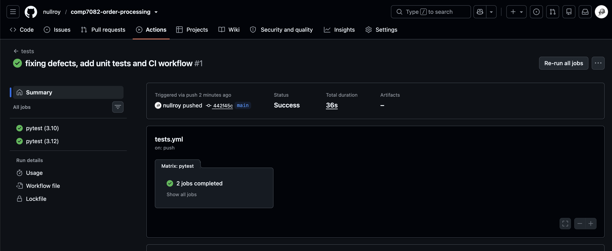

# Defects found and fixed

15 defects. Each one lists where it was, what went wrong, the fix, and the test that covers it.

## Cart (`cart.py`)

1. **No quantity validation.** `add_item` took 0, negatives, floats, strings and `True`. Adding -5 lowered the subtotal, and `remove_item('X', -3)` added 3 units.
   Fix: `_validate_quantity` only accepts positive ints (not `bool`). Used by add and remove.
   Tests: `test_add_item_rejects_invalid_quantities`, `test_remove_item_rejects_non_positive_quantity`

2. **Stock check ignored the cart.** With 20 in stock you could add 15 twice.
   Fix: compares cart quantity + new quantity against stock.
   Tests: `test_repeated_adds_cannot_exceed_stock`, `test_add_exactly_all_remaining_stock_is_allowed`

3. **Stale discounted total.** `apply_discount` stored a fixed total, so items added afterwards weren't charged.
   Fix: only the code is stored; the discount is recalculated from the current subtotal.
   Test: `test_discount_recalculates_after_cart_is_edited`

4. **Discounts stacked.** WELCOME10 twice gave 19% off; WELCOME10 then STUDENT20 gave 28%.
   Fix: one code at a time, always applied to the subtotal.
   Test: `test_discounts_do_not_stack`

5. **Negative totals.** A $9.99 cable with SAVE15 came to -$5.01.
   Fix: discount is capped at the subtotal.
   Tests: `test_fixed_discount_never_makes_total_negative`, `test_fixed_discount_at_exact_boundary`

6. **Money as float.** 1 mouse + 7 cables = `99.88000000000001`; 10% of 29.95 = 2.995.
   Fix: `Decimal` everywhere, rounded half-up to cents (`models.to_money`). Order amounts stored as TEXT.
   Tests: `test_subtotal_is_exact_to_the_cent`, `test_percentage_discount_rounds_half_up_to_cents`, `test_product_price_is_returned_as_exact_decimal`

7. **Loading a saved cart twice doubled it,** and items silently vanished if stock had dropped.
   Fix: `load()` replaces the lines, caps quantities at current stock, and returns a list of what it changed.
   Tests: `test_loading_twice_does_not_duplicate_quantities`, `test_load_replaces_unsaved_lines`, `test_load_caps_quantity_when_stock_dropped`

8. **Errors printed and swallowed.** Bad SKU, no stock or a bad coupon just printed and returned `False`, which callers ignored.
   Fix: specific exceptions, all subclasses of `CartError`. A rejected code keeps the previous one.
   Tests: `test_add_unknown_product_raises`, `test_invalid_code_raises_and_keeps_previous_code`, `test_remove_item_partial_full_and_missing`

## Database (`repository.py`, `setup_db.py`)

9. **SQL injection.** `get_product` and `get_saved_cart` used f-strings, so `x' OR '1'='1` returned other rows.
   Fix: parameterized queries.
   Tests: `test_sku_with_sql_injection_is_treated_as_plain_text`, `test_saved_cart_lookup_cannot_read_other_users`

10. **`list_orders` ignored `user_id`** and returned everyone's orders.
    Fix: `WHERE user_id = ?`.
    Test: `test_list_orders_only_returns_that_users_orders`

11. **Stock could go negative, and multi-line updates weren't atomic.**
    Fix: `reserve_order` runs in one `BEGIN IMMEDIATE` transaction with `UPDATE ... WHERE stock >= ?` and a `rowcount` check. Any short line rolls back the whole order. The schema adds `CHECK (stock >= 0)`.
    Test: `test_reserve_is_all_or_nothing_when_one_line_is_short`

12. **Connections leaked on errors,** since `close()` was the last line of each method.
    Fix: context managers close in `finally` and roll back on exceptions. `save_cart` deletes and inserts in one transaction.

## Checkout (`checkout.py`)

13. **Stock was taken before payment and never returned** on a decline or gateway error. Stock also wasn't re-checked at checkout.
    Fix: reserve, charge, then finalize. Out-of-stock fails before charging. Anything except `approved is True` (exceptions, `None`, `'yes'`) counts as unpaid, and the stock goes back.
    Tests: `test_declined_payment_keeps_stock_and_cart`, `test_gateway_exception_is_recorded_and_stock_restored`, `test_malformed_gateway_response_is_not_treated_as_paid`, `test_stock_change_after_adding_to_cart_blocks_checkout`, `test_finalize_declined_restores_stock_only_once`

14. **Cart emptied after a failed payment,** overwriting the saved cart.
    Fix: cleared and saved only when paid.
    Tests: `test_declined_payment_keeps_stock_and_cart`, `test_successful_checkout_charges_discounted_total_and_clears_cart`

15. **Duplicate charges.** `request_id` was never checked, so a retry charged again. The `amount > 1000` block printed a warning and carried on.
    Fix: `request_id` is required and `UNIQUE`. A repeat returns the original result without charging; another user's id raises `CheckoutError`. Dead block removed.
    Tests: `test_repeated_checkout_with_same_request_id_charges_once`, `test_missing_request_id_is_rejected`, `test_request_id_from_another_user_is_rejected`, `test_reserve_rejects_reused_request_id`

Also: the full payment token was printed on every charge. It's now logged with only the last 4 characters. Test: `test_payment_token_is_not_written_to_output`

## Assumptions

- FREESHIP is valid but takes $0 off, since there's no shipping charge.
- Percentage discounts round half-up to the cent. Codes ignore case and spaces.
- One `request_id` is one attempt. Retrying a declined id returns the declined result; the client sends a new id to try another card.
- Saved carts don't keep the discount code.
- Prices are fixed when the item is added to the cart.
- `FakePaymentGateway` is unchanged. Tests also use a small `ExplodingGateway` and a `Mock` for errors and bad responses.

## Known limitation

If the charge succeeds but the database fails before `finalize_order`, the order stays `pending`. A real system would reconcile these with the payment provider.

## Test results

```
$ python -m pytest -q
..................................................                       [100%]
50 passed in 0.34s
```

37 test functions (50 cases with parametrize). Each test uses its own temporary SQLite file.

## CI

`.github/workflows/tests.yml` runs on every push and pull request, on Python 3.10 and 3.12.

[Successful run: https://github.com/USERNAME/REPO/actions/runs/](https://github.com/nullroy/comp7082-order-processing/actions/runs/45081564700)


